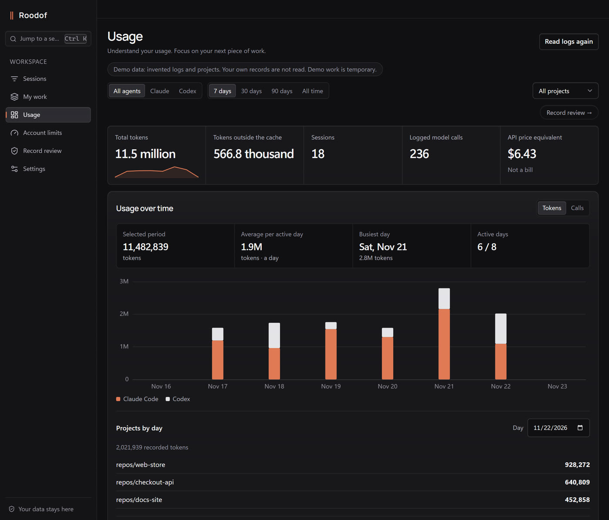
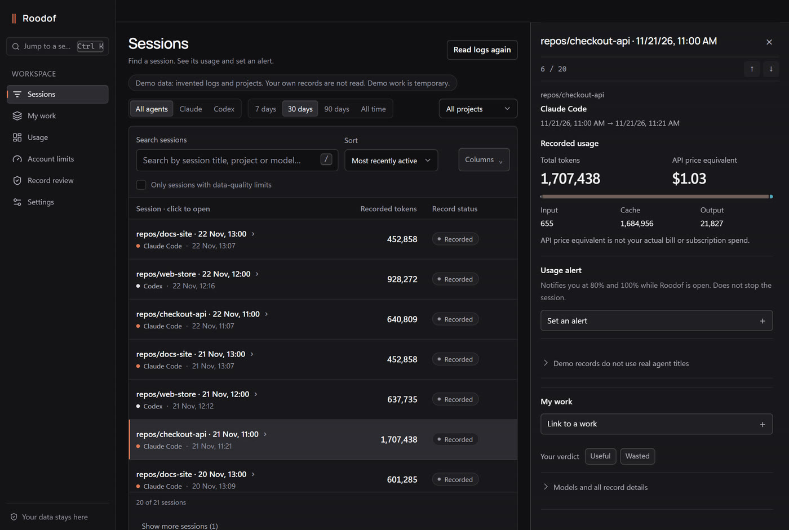
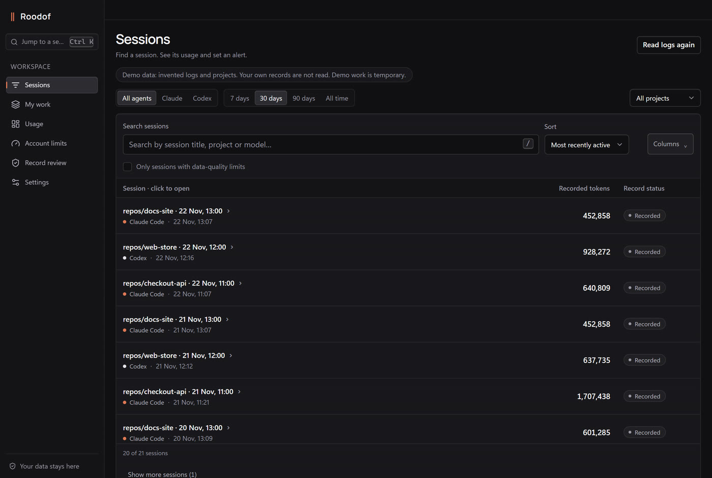
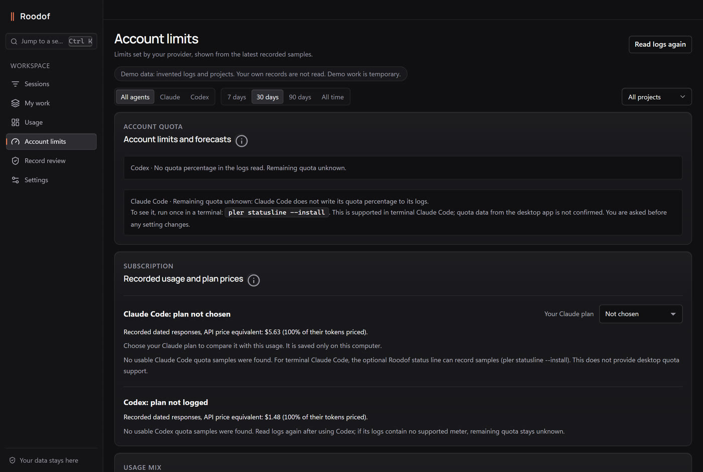
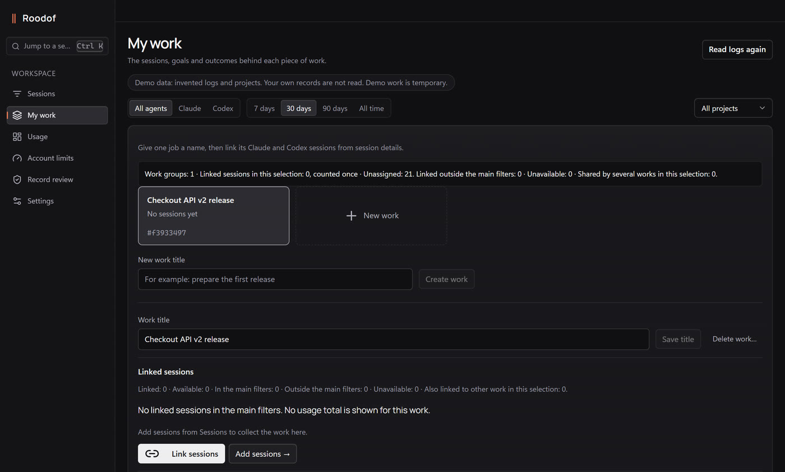
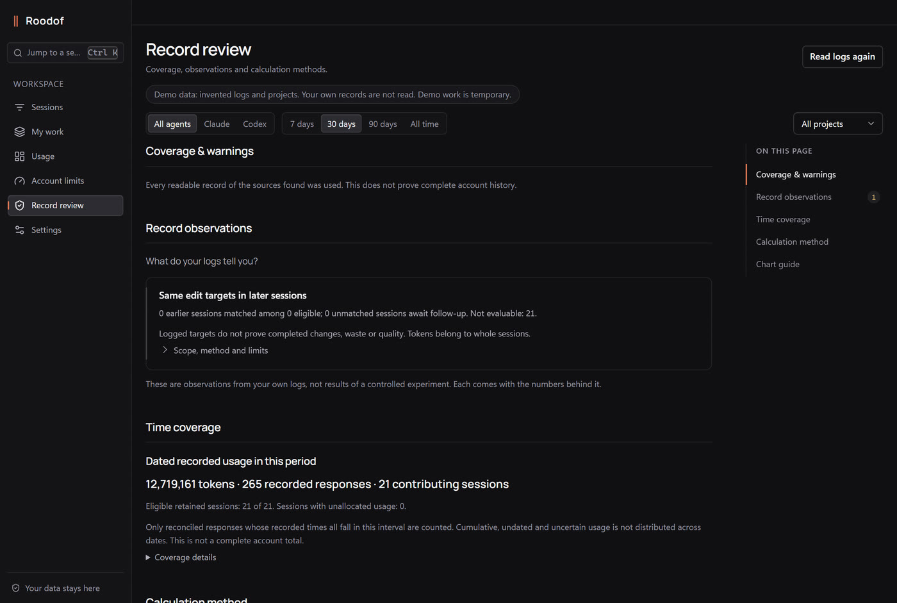

# Roodof: Claude Code & Codex usage tracker for Windows

**English** · [Türkçe](README.tr.md)

See what Claude Code and Codex used, from their own logs on your computer: tokens by project and model, where your subscription quota is heading, and where usage builds up.

[](https://github.com/roodof/roodof/releases) [](LICENSE) 

**[Download the free Windows beta](https://roodof.com/)** · no account, no signup


<sub>All screenshots use invented demo data. Roodof reads your own Claude Code and Codex logs on your computer.</sub>

**What it shows**

- Tokens per day for Claude Code and Codex, side by side
- **Projects by day:** pick a day and see which repo used the most tokens
- Tokens by project and model, and where your 5-hour and weekly quota is heading
- API price equivalent, clearly marked as not your subscription bill

**How it handles your data**

- **Calls no model.** Measuring costs zero tokens.
- **Agent data stays local.** The app works on this computer only (`127.0.0.1`) and analyses usage offline. The optional update check sends no agent records or project data.
- **Agent logs stay unchanged.** Roodof keeps a metadata cache. Prompts, replies, commands and tool output never reach the page or the cache.

## Get started on Windows

1. Download **[Roodof-Setup-0.9.31.exe](https://roodof.com/downloads/Roodof-Setup-0.9.31.exe)**. It installs for your user only: no administrator rights and no separate Python needed.
2. The installer is not code-signed yet, so Windows SmartScreen may show a warning. Choose **More info → Run anyway** if you trust the download. The file sizes and SHA-256 hashes are listed on [roodof.com](https://roodof.com/).
3. Open Roodof from Start or the desktop shortcut and choose **See your sessions**. If nothing appears, widen the filters or use **Add a log folder** (for example a running WSL distribution).

**Try it without your own data:** download the portable ZIP from [roodof.com](https://roodof.com/), extract it into a new folder and open `Roodof-Demo.cmd`. It shows invented logs only.

More: [installation and updates](docs/SETUP.md) · [desktop scope](docs/DESKTOP.md) · [update details](docs/UPDATES.md) · [how Roodof compares with ccusage and other trackers](https://roodof.com/ccusage-alternative-windows/)

## A quick tour

### Usage: where today's tokens went

The **Usage** screen (shown at the top) puts Claude Code and Codex on one chart. Click a day, or pick it under **Projects by day**, to see the recorded tokens per project for that day. Filter by agent, period (7, 30 or 90 days, or all time) and project.

### Session details and usage alerts



Open any session to see its input, cache and output tokens and its API price equivalent. Set an optional token or dollar alert: Roodof warns at 80% and 100% while it is open. It does not stop the agent. Mark a session **Useful** or **Wasted** to see what wasted sessions cost, and link it to a piece of work.

### Sessions



Search by project, model or session code. Sort by last activity, start, tokens, or errors and interruptions.

### Account limits



Shows where your 5-hour and weekly quotas were last and whether they fill before they reset at the current pace. Codex writes its quota to its logs. Claude Code does not, so run `roodof statusline --install` once in a terminal to record it. This works with terminal Claude Code on Pro and Max plans. You can also compare recorded usage at API list prices with your plan's monthly price.

### My work and record review

| My work | Record review |
|---|---|
|  |  |
| Give a job a name and link its Claude Code and Codex sessions. Add a goal and your own outcome note. | See which records were read, observations from your logs with the numbers behind them, and how every total is calculated. |

## What it reads

| Agent | Folder | To change |
|---|---|---|
| Claude Code | `~/.claude/projects`, `~/.config/claude/projects` | `CLAUDE_CONFIG_DIR` |
| Codex | `~/.codex/sessions`, `~/.codex/archived_sessions` | `CODEX_HOME` |

Claude Code deletes transcripts older than 30 days by default. Roodof keeps the metadata it already extracted, so monthly totals do not silently shrink. No prompt, reply, command or tool output is kept.

## Command line and Python edition

The Python edition needs Python 3.9 or newer and has no other dependencies. From this repository's root:

```
pipx install .
roodof                         # open the page in your browser
roodof demo                    # the page with invented logs
roodof report --json           # machine-readable report
roodof statusline --install    # record Claude Code quota (asks first, keeps a backup)
roodof backup create "my-history.roodof-backup.zip"
```

The portable Windows package uses `Roodof.cmd` instead of `roodof`. Every command, option and data rule is in the **[full reference](docs/REFERENCE.md)**.

## Limits

- The packaged app is Windows-only for now. The Python edition is tested on Windows, Linux and macOS.
- The installer is not code-signed yet.
- Claude Code quota needs the status line, which runs only in terminal Claude Code.
- The API price equivalent is not your bill. Observations come from your own logs, not from a controlled experiment.
- Roodof is an independent tool. It is not made by, or affiliated with, Anthropic or OpenAI.

## Support and contributing

Questions and bug reports: [GitHub issues](https://github.com/roodof/roodof/issues) or plersolutions1st@gmail.com. Please do not attach caches, archives or agent logs. See [CONTRIBUTING.md](CONTRIBUTING.md) and, for security reports, [SECURITY.md](SECURITY.md). Tests: `python -m pytest`.

## License

MIT. See [LICENSE](LICENSE). Design reference copies in `docs/design-references` keep their own licenses.
