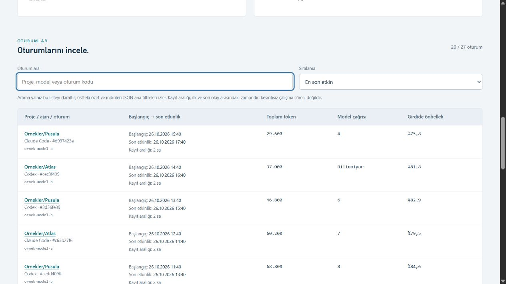

# PLER

[English](README.md) · **Türkçe**

Claude Code ve Codex'in ne kullandığını, bilgisayarındaki kendi kayıtlarından gösterir: hangi projede, hangi modelle, ne kadar token; kotanın nereye gittiği; harcamanın nerede biriktiği.

- **Model çağırmaz.** Ölçmek için tek bir token harcamaz.
- **Hiçbir şey göndermez.** İnternete bağlanmaz; sayfa yalnız bu bilgisayardan açılır (`127.0.0.1`).
- **Ajan kayıtlarını değiştirmez.** PLER üst bilgi önbelleği tutar; istek, yanıt, komut ve araç çıktısı ekrana ve önbelleğe girmez. İsteğe bağlı durum satırı, Claude Code ayarını onaydan sonra ve yedek alarak değiştirir.
- **Her dilde çalışır.** Kaynak kodunu okumadan ajan kayıtlarını ve yerel Git hareketlerinin üst bilgilerini inceler.

## Kurulum

Python 3.9 veya üstü yeter; başka bağımlılık yoktur.

Dış proje klasöründen:

```
pipx install ./product
```

`pipx` yoksa `pip install ./product` da olur. (PyPI'da yayımlanınca: `pipx install pler`.)
Zaten `product/` klasöründeysen `pipx install .` kullan.

## Kullanım

```
pler
```

Tarayıcıda **Kullanımım** sayfası açılır. Kapatmak için sayfadaki **Kapat** düğmesi ya da terminalde Ctrl+C.

Sekmeyi elle açarken başlangıçta yazılan tam adresi kullanın. Bu adres çalışan rapora erişim sağlar; yeniden başlatınca değişir, paylaşmayın. Sayfa erişim bölümünü görünen adresten kaldırır. Raporu okumak ve indirmek de bu erişim anahtarını gerektirir. Ürün kişisel ve yereldir; ekip hesapları ve paylaşımlı sunucu kurulumu desteklenmez.

**Dil:** Sayfa tarayıcının diliyle açılır; üstteki düğmeyle İngilizce ve Türkçe arasında geçilir. Terminal Türkçe bir sistemde Türkçe, diğerlerinde İngilizce konuşur; `PLER_LANG=tr` ya da `PLER_LANG=en` ile seçilebilir.

```
pler report             # son 30 günde etkin oturumlar
pler report --days 0    # bütün kayıtlar
pler report --json      # makinenin okuyacağı biçim
```

## Ne gösterir

- **Durumun:** Kayıtlardan çıkan, dayanağı yanında yazan gözlemler. Örneğin uzun oturumlarda her model çağrısının kısa oturumlara göre kaç kat token harcadığı, ya da harcamanın çoğunun tek bir oturumda toplanması.
- **Kota:** Codex'in ve Claude Code'un 5 saatlik ve haftalık kotasının en son nerede olduğu, mevcut hızla sıfırlanmadan dolup dolmayacağı. Claude Code için bir kez [durum satırını](#claude-code-kotası) açman gerekir.
- **Toplamlar:** Token bileşimi: yeni girdi, önbellekten okunan, önbelleğe yazılan ve çıktı. Önbellek dışı miktar ayrıca yazılır, çünkü ajan tokenlarının büyük kısmı aynı bağlamın yeniden okunmasıdır.
- **Projeler, modeller, oturumlar:** Oturumlar git deposuna göre gruplanır. Geçici klasörlerdeki oturumlar tek bir grupta toplanır.
- **Oturumlarını bul:** Proje, model veya kısa oturum koduyla ara. En son etkinlik, başlangıç, token kullanımı ya da hata ve kesinti sayısına göre sırala. Her satırın kendine ait kodu, başlangıcı ve son etkinliği vardır.



Arama yalnız oturum listesini daraltır. Sayfanın üstündeki özet ve indirilen JSON, dönem / ajan / proje seçimini izler. İndirilen özette liste aramasının dışındaki oturumlar da bulunabilir.

Özet hazırlanırken indirme düğmesi durumu gösterir. Hazırlanan dosya için **Yeniden indir** bağlantısı görünür kalır. Kaydedildiğini tarayıcı indirmelerinden kontrol edin. Ana filtreleri değiştirmek veya kayıtları yeniden okumak eski bağlantıyı kaldırır. Dar ekranda diğer sütunlar için tablo alanına odaklanıp sol/sağ oklarını kullanabilirsiniz.

Oturum ayrıntısındaki **kayıt aralığı**, ilk ve son olay arasındaki zamandır; beklemeleri de içerir. **Çalışma süresi** yalnız ajan kaydettiyse gösterilir. Dosya düzenleme sayısı, değişikliklerin Git'te korunduğunu veya işin tamamlandığını kanıtlamaz.

**Veri kalitesi:** Kopya yanıtlar sayım öncesinde uzlaştırılır. Kanıtlanamayan model/proje atfı bilinmiyor gösterilir. Geçersiz kayıtlar ve uzlaştırılamayan birikimli/dallanmış/bağlamı özetlenmiş geçmiş açıkça işaretlenir; görünen toplam eksik olabilir. Bilinen toplam, hesabın tüm kullanımının kapsandığını kanıtlamaz. JSON, uygulama/okuyucu/şema sürümleriyle kalite işaretlerini içerir. Karar vermeden önce [sayım sözleşmesini](ACCOUNTING.md) inceleyin. Oturum uzunluğu karşılaştırmaları israfı veya tasarrufu kanıtlamaz.

## Yerel Git hareketleri

Oturumu açınca, ilk ve son kaydı arasındaki yerel Git hareketleri de görünür: commit, commit düzeltmesi, checkout, reset, merge ve rebase. Aynı anda başka kişiler ve ajanlar da çalışmış olabilir; bu kayıtlar yazarı veya değişikliklerin korunduğunu kanıtlamaz. Bir hareket birden fazla oturumla eşleşebilir; oturum sayılarını toplayarak benzersiz commit sayısı çıkarılamaz.

**Kayıtları yenile** sırasında her oturumun bağlı olduğu depoların `.git/logs/HEAD` dosyası kontrol edilir. Bir depo şu durumlarda bağlı sayılır:
- oturumun çalışma klasörü o depodadır;
- oturum o deponun içindeki bir dosyayı düzenlemiştir. Claude Code'un düzenleme araçları ve Codex yamaları hedef dosyalarını kayda geçirir.

Böylece üst klasörde başlatılan bir ajan da değiştirdiği depoya bağlanır. Depo yolları yalnız bellekte tutulur; sayfada yalnız kaç depoya bakıldığı görünür. `gitdir` dosyası kullanan worktree ve alt depolar desteklenir. Filtre değiştirmek Git dosyalarını yeniden okutmaz.

Ekrana ve JSON'a yalnız olay zamanı, sabit işlem türü ve hedef commit'in ilk sekiz karakteri gider. Yazar adı, e-posta, commit mesajı, dal adı, kaynak dosyalar ve Git ayarları dahil edilmez. Git komutu çalıştırılmaz ve bu bilgiler kalıcı önbelleğe yazılmaz.

Yerel günlük silinmiş, süresi dolmuş veya kapalı olabilir. Her projenin günlüğünden en fazla son 1 MiB okunur; eşleşen en yeni 20 hareket listelenir, sayaç okunan bölümdeki tüm eşleşmeleri kapsar. Eksik tarihler ve kısmi ya da okunamayan geçmiş açıkça gösterilir. Sıfır eşleşme, iş yapılmadığı anlamına gelmez. Ağ yolları, sembolik bağlantılar, Windows junction'ları ve ev klasöründeki depolar atlanır. Bare depolar ve başka worktree'lerin hareketleri dahil edilmez.

## Claude Code kotası

Claude Code kota yüzdesini kayıtlarına yazmaz, ama Pro ve Max aboneliklerde durum satırına verir. Bir kez şunu çalıştır:

```
pler statusline --install
```

- **Ne olur:** Claude Code'un `settings.json` dosyasına hangi satırın ekleneceği gösterilir ve onayın sorulur. Önce dosyanın bir yedeği alınır.
- **Mevcut durum satırın varsa:** Ona dokunulmaz. Kendi betiğinden PLER'e nasıl veri verebileceğin yazılır.
- **Sonrasında:** Claude Code'un alt satırında `bağlam %37 · 5 saat %24 · hafta %41` gibi bir satır görünür. PLER bu satırdan yalnız kota yüzdelerini ve sıfırlanma zamanlarını, değiştiklerinde önbellek klasörüne yazar; konuşma, klasör ve oturum bilgisi saklanmaz.
- **Ekranda:** Claude Code kotası Codex'inki gibi "ne zaman dolar" tahminiyle görünür.
- **Geri almak için:** `pler statusline --remove`

Yalnız mevcut PLER kurulumunun ürettiği, değiştirilmemiş satır kaldırılır. Özel betik, düzenlenmiş satır veya başka kurulum yoluna işaret eden komut korunur. Onay beklerken değişen ayarın üzerine yazılmaz; kontrol ettikten sonra yeniden dene.

## Neyi okur

| Ajan | Klasör | Değiştirmek için |
|---|---|---|
| Claude Code | `~/.claude/projects`, `~/.config/claude/projects` | `CLAUDE_CONFIG_DIR` |
| Codex | `~/.codex/sessions`, `~/.codex/archived_sessions` (sıkıştırılmış olanlar dahil) | `CODEX_HOME` |

Codex'in sıkıştırılmış kayıtları ek kurulum gerektirmeden okunur. Python 3.14 ve üstünde standart kütüphane bunları hızlı açar. Daha eski Python'da `pip install "pler[fast]"` aynı hızı verir. İkisi de yoksa yerleşik çözücü çalışır ama yavaştır: bir test bilgisayarında ilk okuma 7 yerine 23 saniye sürdü. Sonraki okumalar önbellekten gelir.

Bağımlılıksız okuyucuda tekrarlanan sayaç karşılaştırmaları ve önbelleğin yazılması iyileştirildi. Büyük arşivlerin ilk okunması hâlâ zaman alır; [hız doğrulaması](../reports/cold-start-v1/REPORT.md), boş PLER önbelleğiyle okumayı sonraki okumalardan ayrı ölçer.

Değişmeyen Claude Code ve Codex kayıtlarının üst bilgileri önbellekte tutulur; sonraki okumada özgün konuşma tekrar ayrıştırılmaz. Önbellek sayı, zaman, kimlik, proje yolu ve araç üst bilgisi içerir; istek, yanıt, komut ve araç çıktısı metni içermez. Özel yerel üst bilgidir, anonim dosya değildir. Yeri:
- Windows: `%LOCALAPPDATA%\pler`
- macOS: `~/Library/Caches/pler`
- Linux: `~/.cache/pler`

`PLER_CACHE_DIR` ile yeri değiştirilebilir. Silinirse bir sonraki açılışta yeniden oluşur.
Bozulmuş veya eski biçimdeki önbellek girdileri özgün kayıttan yeniden okunur. Sağlama toplamı kazara değişiklikleri yakalar; önbelleği ve sağlama toplamını birlikte değiştirebilen birine karşı koruma değildir.
Okuyucuyu veya doğrulama yardımcılarını değiştiren güncellemeden sonra ilgili önbellek ilk okumada yeniden kurulur. Okunurken büyüyen ya da erişimi yarıda kesilen dosya sonraki okumada tekrar denenir. Önbellek değiştirilemezse önceki dosya korunur; izin verildiği sürece geçici dosya temizlenir.

## Güven ve veri kalitesi

Ekran tarihli bir anlık görüntü gösterir. Kısa pencerelerde 30 dakikadan, günlük/haftalık pencerelerde 24 saatten eski ölçümlerden tahmin çıkarılmaz. Bunlar sağlayıcının kuralları değil, PLER'in temkinli güncellik sınırlarıdır. Sıfırlanma veya tahmini dolma zamanı geçtiyse güncel doluluk bilinmiyor diye gösterilir. Açık sayfa bu etiketleri kendi saatiyle günceller; hesabı sorgulamaz ve kayıtları yeniden okumaz.

Tamamen okunamayan Claude Code ve Codex dosyaları sayılır. Bozuk JSON, geçersiz kayıt kimliği veya yarım kalmış son satır varsa sağlam satırlar korunur; toplamın eksik olabileceği belirtilir. Her iki ajanın dosyası önbellekten okunurken de uyarı korunur. Hiç kayıt olmaması ile eksik okuma ayrılır. Geçersiz kota sayıları reddedilir. Bulunan dosya sayısı, her konuşma satırının geçerli veya her ajan sürümünün desteklendiği anlamına gelmez.

Sıkıştırılmış Codex dosyalarının çerçeveleri tam olmalı ve belirtilen boyutlar tutmalıdır. Dosyada varsa zstd içerik sağlama toplamı yerleşik okuyucuyla doğrulanır. Açılan byte'lara güvenilemeyeceği için bozuk sıkıştırılmış dosya bütünüyle dışarıda bırakılır ve bildirilir. Sağlama toplamı olmayan dosyada her veri değişikliği yakalanamaz. Proje gruplarken ve Git üst bilgisi okurken UNC ağ yolları ve sembolik bağlantı/junction içeren üst klasörler izlenmez.

Claude kayıtları sabit kimlik veriyorsa kopyalanmış istek ve araç çağrıları bir kez sayılır. Bu kimlikler yoksa ayrı satırların kopya olduğu güvenle anlaşılamaz.

Token kullanımı fiyat veya ölçülmüş tasarruf değildir. Ekrandan indirilen özet ve `pler report --json --sessions`; kaynak dosya yolu, ham oturum kimliği, dal adı, düzenlenen dosyaların yolları ve kayıttaki serbest notları içermez. Kısaltılmış proje adları, zamanlar, model adları ve sayılar içerir; anonim paylaşım dosyası değildir. Ayrıntılı terminal JSON'u ekranla aynı oturum alanlarını kullanır. Günlük harcama çağrıştıran `days` dizisi kaldırılmıştır: dönem, etkin oturumları seçer ve bu oturumların tamamının toplamını içerir.

Bu kaynak kopyadan güncellerken PLER'i kapat, dış klasörden `pip install --upgrade ./product` çalıştır ve yeniden aç. `pler --version` kurulu sürümü gösterir. Açık sayfa başladığı sürümün dosyalarını kullanır; güncel kod için PLER'i yeniden başlat. Sürüm ve JSON değişiklikleri [değişiklik kaydında](CHANGELOG.md) listelenir.

[Kalite kaydı](QUALITY.md), düzeltilmiş hatalarla açık kullanıcı itirazlarını ayırır. Otomatik testler Windows, Linux ve macOS'ta Python 3.9–3.14 ile geçiyor. İmzalı ve Python gerektirmeyen kurulum, her sistemde gerçek tarayıcı kabulü ve profesyonellerin günlük işinde fayda kanıtı hâlâ açık.

## Sınırlar

- Claude Code kota yüzdesini kayıtlarına yazmaz. Durum satırı açık değilse yalnız sınıra takılma sayısı gösterilir. Durum satırı açıksa da kota, Claude Code'un çalıştığı anlardaki değerlerdir; Claude'u başka yerlerde (web, masaüstü) kullanman aynı kotayı tüketir ve bir sonraki Claude Code yanıtında görünür.
- Durum satırı, terminaldeki Claude Code'un özelliğidir. Claude masaüstü uygulamasının bu komutu çalıştırdığı doğrulanmadı; denemede 15 dakika boyunca hiç örnek gelmedi.
- Hesap kotası proje ve ajan filtrelerinden bağımsızdır. Kayıtlı sınır olayı olmaması, kalan kotanın bilindiği anlamına gelmez.
- Para karşılığı gösterilmez; sayılar ajanların kendi kaydettiği tokenlardır.
- "Durumun" bölümündeki gözlemler kayıtlardan çıkar; kontrollü bir deneyin sonucu değildir.

## Söz verilenin denetimi

[tests/test_trust.py](tests/test_trust.py) şunları sınar:
- kaynak kodda bağlantı açabilen ya da program başlatabilen bir modül olmadığını;
- tam bir kullanım boyunca yalnız `127.0.0.1` ile konuşulduğunu ve hiçbir program başlatılmadığını;
- ekrana ve önbelleğe kayıt metninin girmediğini.

```
python -m pytest
```
