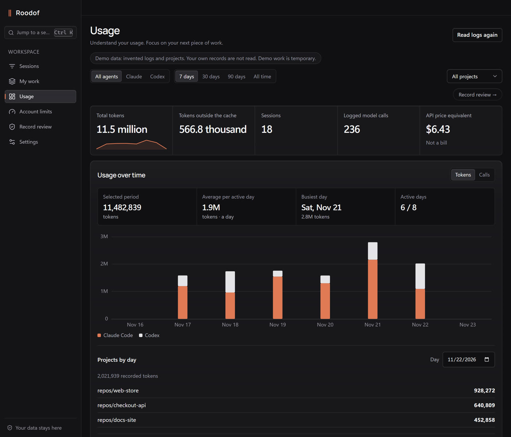
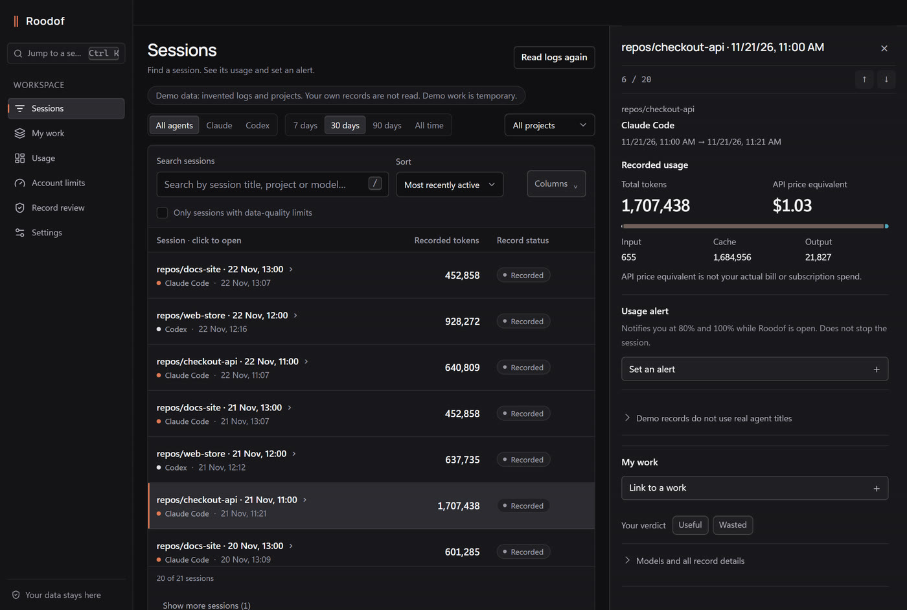
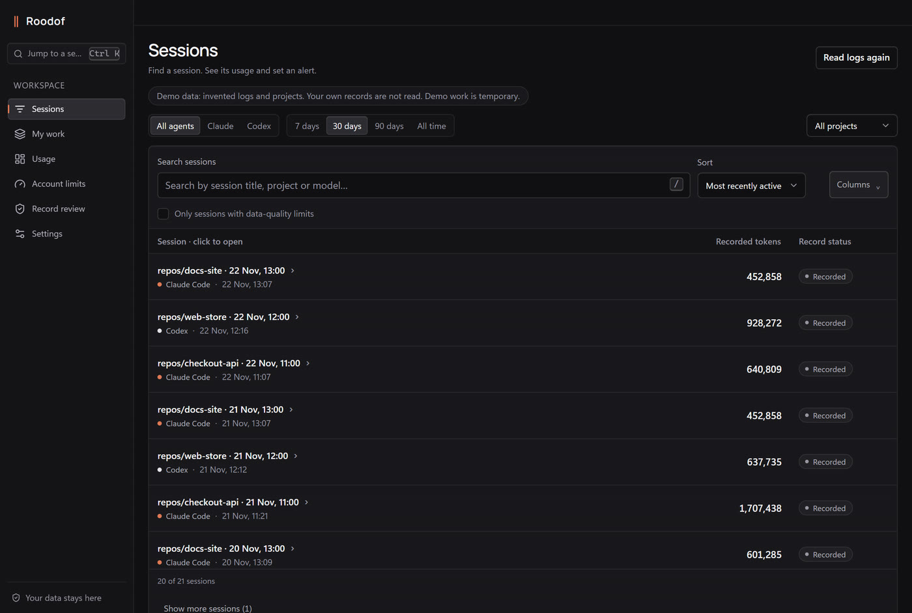
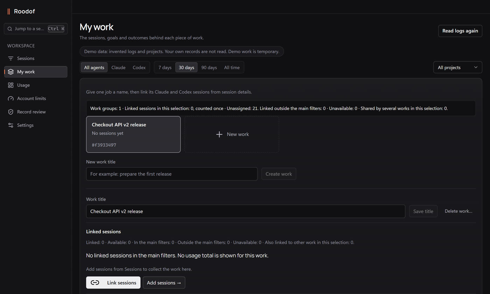
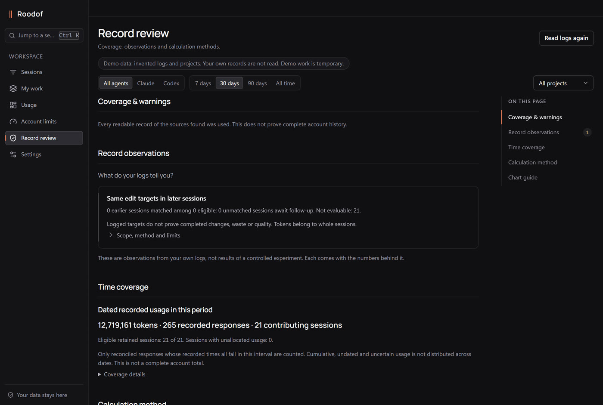

# Roodof

[English](README.md) · **Türkçe**

Claude Code ve Codex'in ne kullandığını, bilgisayarındaki kendi kayıtlarından gösterir: hangi projede, hangi modelle, ne kadar token; kotanın nereye gittiği; harcamanın nerede biriktiği.

[](https://github.com/roodof/roodof/releases) [](LICENSE) 

**[Ücretsiz Windows betasını indir](https://roodof.com/tr/)** · hesap ve kayıt gerekmez


<sub>Tüm ekran görüntülerinde uydurma örnek veri var. Roodof senin bilgisayarındaki Claude Code ve Codex kayıtlarını okur. Görüntüler İngilizce arayüzden; uygulama Türkçe de kullanılabilir.</sub>

**Neler gösterir**

- Claude Code ve Codex için günlük token kullanımı, yan yana
- **Güne göre projeler:** bir gün seç, en çok token kullanan repoyu gör
- Proje ve modele göre token; 5 saatlik ve haftalık kotanın gidişi
- API fiyat karşılığı; abonelik faturası olmadığı açıkça belirtilir

**Verine nasıl davranır**

- **Model çağırmaz.** Ölçmek için tek bir token harcamaz.
- **Ajan verisi yerel kalır.** Uygulama yalnız bu bilgisayarda çalışır (`127.0.0.1`) ve kullanımı çevrimdışı analiz eder. İsteğe bağlı güncelleme kontrolü ajan kayıtlarını veya proje bilgilerini göndermez.
- **Ajan kayıtları değişmez.** Roodof bir üst veri önbelleği tutar. İstemler, yanıtlar, komutlar ve araç çıktıları sayfaya veya önbelleğe ulaşmaz.

## Windows'ta başlarken

1. **[Roodof-Setup-0.9.31.exe](https://roodof.com/downloads/Roodof-Setup-0.9.31.exe)** dosyasını indir. Yalnız senin kullanıcı hesabına kurulur: yönetici izni ve ayrı Python kurulumu gerekmez.
2. Kurulum dosyası henüz kod imzalı değil, bu yüzden Windows SmartScreen uyarı gösterebilir. İndirmeye güveniyorsan **Ek bilgi → Yine de çalıştır** seç. Dosya boyutları ve SHA-256 değerleri [roodof.com](https://roodof.com/tr/) sayfasında.
3. Roodof'u Başlat'tan veya masaüstü kısayolundan aç ve **Oturumlarını gör** seç. Bir şey görünmezse filtreleri genişlet ya da **Kayıt klasörü ekle** ile başka bir klasör seç (örneğin çalışan bir WSL dağıtımı).

**Kendi verin olmadan dene:** taşınabilir ZIP'i [roodof.com](https://roodof.com/tr/) sayfasından indir, yeni bir klasöre çıkar ve `Roodof-Demo.cmd` dosyasını aç. Yalnız uydurma kayıtları gösterir.

Ayrıntı: [kurulum ve güncelleme](docs/SETUP.md) · [masaüstü kapsamı](docs/DESKTOP.md) · [güncelleme ayrıntıları](docs/UPDATES.md)

## Kısa tur

### Kullanım: bugünün tokenları nereye gitti

**Kullanım** ekranı (en üstteki görsel) Claude Code ve Codex'i tek grafikte gösterir. Bir güne tıkla ya da **Güne göre projeler** bölümünden seç; o gün her projede kaydedilen tokenları gör. Ajana, döneme (7, 30, 90 gün veya tümü) ve projeye göre filtrele.

### Oturum ayrıntısı ve kullanım uyarısı



Herhangi bir oturumu açıp girdi, önbellek ve çıktı tokenlarını ve API fiyat karşılığını gör. İstersen token veya dolar uyarısı kur: Roodof açıkken %80 ve %100'de uyarır, ajanı durdurmaz. Oturumu **İşe yaradı** ya da **Boşa gitti** diye işaretleyerek boşa giden oturumların ne tuttuğunu gör ve oturumu bir işe bağla.

### Oturumlar



Proje, model veya oturum koduyla ara. Son etkinliğe, başlangıca, tokena ya da hata ve kesintilere göre sırala.

### Hesap limitleri


5 saatlik ve haftalık kotanın en son nerede olduğunu ve mevcut hızla sıfırlanmadan dolup dolmayacağını gösterir. Codex kotasını kayıtlarına yazar. Claude Code yazmaz; kaydetmek için terminalde bir kez `roodof statusline --install` çalıştır. Bu, Pro ve Max planlarında terminaldeki Claude Code ile çalışır. Kayıtlı kullanımın API liste fiyatını planının aylık fiyatıyla da karşılaştırabilirsin.

### Çalışmalarım ve kayıt incelemesi

| Çalışmalarım | Kayıt incelemesi |
|---|---|
|  |  |
| Bir işe ad ver, onun Claude Code ve Codex oturumlarını bağla. Hedef ve kendi sonuç notunu ekle. | Hangi kayıtların okunduğunu, kayıtlarından çıkan gözlemleri arkasındaki sayılarla ve her toplamın nasıl hesaplandığını gör. |

## Neyi okur

| Ajan | Klasör | Değiştirmek için |
|---|---|---|
| Claude Code | `~/.claude/projects`, `~/.config/claude/projects` | `CLAUDE_CONFIG_DIR` |
| Codex | `~/.codex/sessions`, `~/.codex/archived_sessions` | `CODEX_HOME` |

Claude Code varsayılan olarak 30 günden eski kayıtları siler. Roodof daha önce çıkardığı üst veriyi saklar; böylece aylık toplamlar sessizce küçülmez. İstem, yanıt, komut veya araç çıktısı saklanmaz.

## Komut satırı ve Python sürümü

Python sürümü Python 3.9 veya üstünü ister, başka bağımlılığı yoktur. Bu deponun kökünden:

```
pipx install .
roodof                         # sayfayı tarayıcıda aç
roodof demo                    # uydurma kayıtlarla sayfa
roodof report --json           # makinece okunur rapor
roodof statusline --install    # Claude Code kotasını kaydet (önce sorar, yedek alır)
roodof backup create "gecmisim.roodof-backup.zip"
```

Taşınabilir Windows paketinde `roodof` yerine `Roodof.cmd` kullanılır. Tüm komutlar, seçenekler ve veri kuralları **[başvuru belgesinde](docs/REFERENCE.tr.md)**.

## Sınırlar

- Paketli uygulama şimdilik yalnız Windows'ta. Python sürümü Windows, Linux ve macOS'ta test ediliyor.
- Kurulum dosyası henüz kod imzalı değil.
- Claude Code kotası, yalnız terminaldeki Claude Code'da çalışan durum satırını gerektirir.
- API fiyat karşılığı faturan değildir. Gözlemler kendi kayıtlarından gelir, kontrollü bir deneyin sonucu değildir.
- Roodof bağımsız bir araçtır. Anthropic veya OpenAI tarafından yapılmamıştır, onlarla bağlantılı değildir.

## Destek ve katkı

Soru ve hata bildirimi: [GitHub issues](https://github.com/roodof/roodof/issues) veya plersolutions1st@gmail.com. Lütfen önbellek, arşiv veya ajan kaydı ekleme. Katkı için [CONTRIBUTING.md](CONTRIBUTING.md), güvenlik bildirimleri için [SECURITY.md](SECURITY.md). Testler: `python -m pytest`.

## Lisans

MIT. Bkz. [LICENSE](LICENSE). `docs/design-references` içindeki tasarım referansı kopyaları kendi lisanslarını korur.
